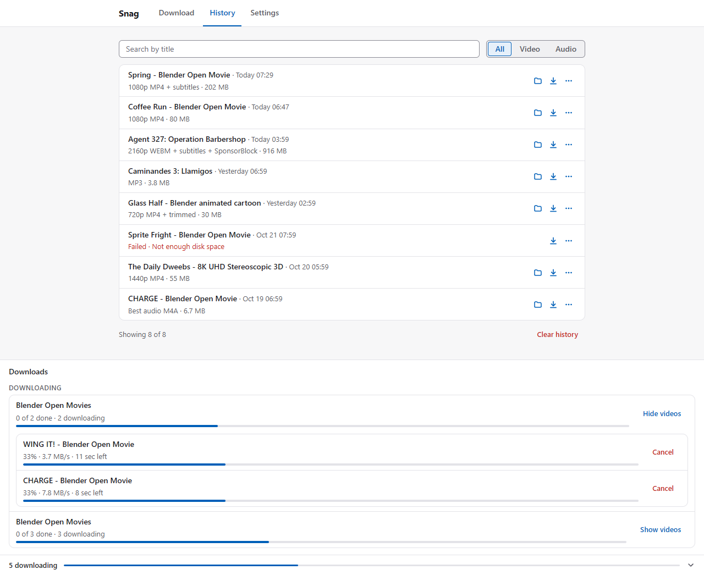
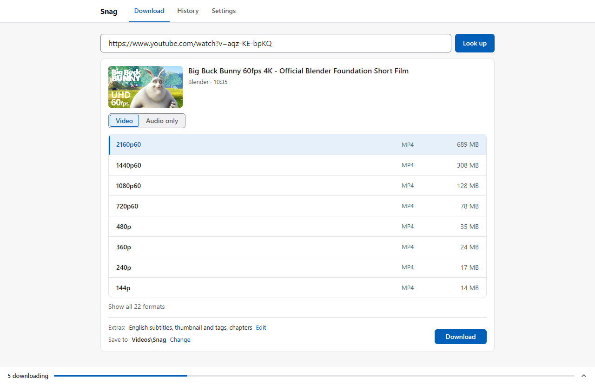
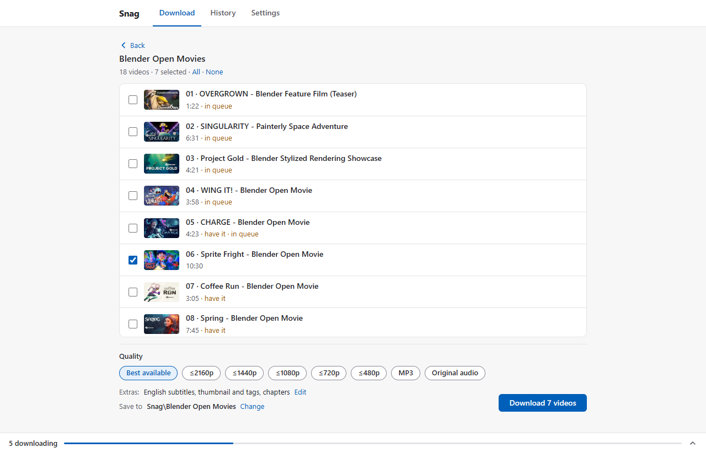
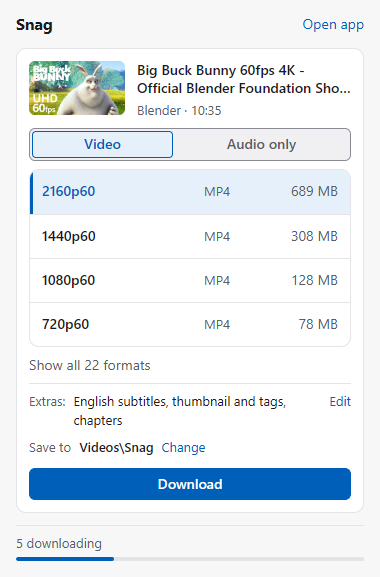

# Snag

A front end for [yt-dlp](https://github.com/yt-dlp/yt-dlp), the command-line video and audio
downloader, built for personal use on one Windows PC. Instead of typing yt-dlp commands, you click
a button in the browser, pick a quality from a short list, and Snag runs the download, keeps the
history and tells you in plain English when something goes wrong.



## What it does

Snag has three parts:

- **A tray app.** A small Python program that starts with Windows, sits in the notification area
  and drives yt-dlp, ffmpeg and Deno. It downloads those tools itself on first start, checks them
  against their published checksums, and offers yt-dlp updates daily, installing one only when you
  approve it; a failed update leaves the working version in place.
- **A local web page** at `http://127.0.0.1:47823/`, served only to your own Windows user on your
  own PC. Paste a link, pick a quality, follow the download queue, browse and search the history,
  and change settings.
- **A Chrome/Edge extension.** A toolbar popup for the page you are on, a **Download with Snag**
  item on the right-click menu, and a **Download** button next to Like and Share on YouTube that
  queues the video with your saved default in one click.

Along the way it:

- turns yt-dlp's long raw format list into one row per resolution, with every format (and its
  codecs) one click away, and pairs each video with the right audio track, in the original
  language when a video also has dubbed audio;
- adds the extras you choose: subtitles (inside the video or as a separate file), thumbnail and
  tags, chapters, SponsorBlock (cut segments out or just mark them) and trimming to a time range;
- lets you tick the videos you want from a playlist and download them with one quality setting;
- runs up to 5 downloads at once, each one cancellable, and resumes interrupted downloads after a
  restart;
- explains every failure with a next step ("Sign in to YouTube in Chrome or Edge, then retry",
  "Not enough disk space"), keeps yt-dlp's own output under Details, slows down when a site starts
  throttling, and recovers on its own where it can;
- warns before you download something that is already in your history.

<p>
  
  
</p>
<p>
  
</p>

The screenshots come from a scratch copy of Snag with a stand-in for yt-dlp and invented history,
not from real downloads.

Snag is for downloading what you have the right to download, for your own use.

## How to run it

You need Windows 10 or 11 and [Python 3.12 or newer](https://www.python.org/downloads/) from
python.org (when installing it, tick **Add python.exe to PATH**). The Microsoft Store's Python won't
do: it keeps what it writes to `%LOCALAPPDATA%` in a private folder of its own, where Snag wouldn't
find its data, so setup refuses it.

1. Put the Snag folder where you want it to live (the shortcuts point into it).
2. In that folder, open PowerShell and run:

   ```powershell
   powershell -ExecutionPolicy Bypass -File setup.ps1
   ```

   It creates the virtual environment `.venv`, installs Snag's dependencies, makes a **Snag**
   shortcut in the Start menu and one in your Startup folder (so Snag starts with Windows), then
   starts Snag and opens its tab. Running it again is safe: once the Start menu shortcut is there
   (only setup makes it), setup makes it again and leaves **Start with Windows** as you set it in
   Snag's Settings. If Snag is running, setup stops and asks you to quit it from the tray icon
   first (Snag's files can't be updated while it runs). To see what it would do without changing
   anything, add `-DryRun`. Started with **Run with PowerShell** from Explorer's menu, its window
   waits for Enter before it closes.
3. On its first start Snag downloads yt-dlp, ffmpeg (with ffprobe) and Deno into
   `%LOCALAPPDATA%\Snag\bin`, checking each against its published checksum. The tab shows the
   progress; downloads wait until it's done.
4. Add the browser extension (below).

Snag is now in the notification area (next to the clock): click its icon to open the tab, or
right-click it to pause or resume downloads, or quit. To start it again later, use the **Snag**
shortcut in the Start menu.

### The browser extension

Once per browser:

1. Open `chrome://extensions` in Chrome, or `edge://extensions` in Edge.
2. Turn on **Developer mode** (top right in Chrome, left side in Edge).
3. Click **Load unpacked** and choose the `extension` folder inside the Snag folder
   (for example `C:\Snag\extension`).
4. Check that the ID shown on Snag's card is `jpmdepemlhgipdkeancolccbfjeogjko`. Snag answers only
   that ID; it's the same on every PC because it comes from the key in `extension/manifest.json`.
5. Optionally pin it: click the puzzle-piece icon in the toolbar, then the pin next to **Snag**.

Then click Snag's toolbar button on a video page to see the download screen for it, right-click a
link or a page and choose **Download with Snag**, or use the **Download** button next to Like and
Share on YouTube. After Snag's files change (an update of the Snag folder), click the reload arrow on
Snag's card in `chrome://extensions`, then reload any YouTube tabs that were open.

The extension doesn't work in incognito or InPrivate windows, by design: logins from private windows
never reach Snag.

The extension talks only to Snag on your PC, and sends it your cookies for a site only when Snag
says that a page needs you to be signed in: it asks without cookies first, and only then sends that
site's cookies, for that page and its download. Snag keeps them in memory, never on disk except
briefly for the lookup or download that needs them. It also keeps your YouTube login fresh in Snag
(every 30 minutes), so downloads started from Snag's own page work for videos that need it.

### Where things are

| What | Where |
|---|---|
| Snag's data (database, settings, history, queue) | `%LOCALAPPDATA%\Snag\snag.db` |
| yt-dlp, ffmpeg, ffprobe, Deno | `%LOCALAPPDATA%\Snag\bin` |
| Log | `%LOCALAPPDATA%\Snag\snag.log` (and `snag.log.1` to `.3`, the older ones; 1 MB each) |
| Update check state | `%LOCALAPPDATA%\Snag\updater.json` |
| Downloads | `<Videos>\Snag` and `<Music>\Snag` (a **Snag** folder in your Videos and Music folders), unless you choose others in Settings |
| Shortcuts | Start menu: `Snag`; Startup folder: `Snag` (only while **Start with Windows** is on) |

`%LOCALAPPDATA%` is usually `C:\Users\<you>\AppData\Local`; paste it into Explorer's address bar
to get there.

### Troubleshooting

- **"Port 47823 is in use: another program, or Snag running for another Windows user, is using
  it. Quit the other program, or quit Snag in that user's account (or sign them out of Windows),
  then start Snag again."**: something
  else holds the port Snag serves on. Snag runs for one Windows user at a time on a PC (every user's
  Snag would use the same port): if someone else signed in to this PC is running Snag, they need to
  quit it (or sign out) first. Otherwise close the program using the port (or restart the PC), and
  start Snag again.
- **Nothing happens when I start Snag**: it may already be running; starting it again just opens
  its tab. Look for its icon in the notification area (it may be in the hidden icons, behind the
  ^ arrow).
- **Setup stops with "Snag needs Python 3.12 or newer"**: install Python from python.org with
  **Add python.exe to PATH** ticked, open a new PowerShell window, and run `setup.ps1` again. If
  it says the `.venv` folder was made with an older Python, delete `.venv` and run it again.
- **Setup says "This Python is the Microsoft Store's"**: install Python from python.org (above),
  and if setup says so, delete the `.venv` folder; then run `setup.ps1` again.
- **Setup stops with "Snag is running: quit it from the tray icon, then run setup.ps1 again"**:
  right-click Snag's icon in the notification area, choose **Quit**, and run `setup.ps1` again.
- **"Setting up Snag" fails**: check your internet connection and click **Retry** on the setup
  screen in the tab. GitHub limits how often it can be asked; if it says so, wait the time it names.
- **Downloads from YouTube suddenly fail ("YouTube changed something")**: open Settings and click
  **Check now**, then **Update to <version>** (the new version's number). yt-dlp keeps up with
  YouTube's changes; Snag checks for a new version daily unless you turned that off.
- **Snag doesn't start with Windows**: Settings shows **Start with Windows** off when its
  shortcut is missing or Task Manager's Startup tab disabled it. Turn it on (that also clears
  Task Manager's "disabled" mark).
- **Anything else**: the log (`%LOCALAPPDATA%\Snag\snag.log`) records Snag starting and quitting,
  the tools it found, and problems with setup and updates; a download's own error is shown on the
  download in the tab (its Details). To watch the log live, quit Snag from the tray and run it in
  a console from the Snag folder:
  `.venv\Scripts\python -m snag --open` (Ctrl+C quits it).

To remove Snag: quit it, run `.venv\Scripts\python -m snag.platform.startup remove` from the Snag
folder (removes both shortcuts), remove the extension from the browser, then delete the Snag
folder and `%LOCALAPPDATA%\Snag`.

### For developers

```sh
.venv/Scripts/python -m pip install -e ".[dev]"
.venv/Scripts/python -m pytest -q
```

One pytest run covers the Python tests and the JavaScript tests in `tests/js` (run with Node's
built-in test runner, Node 21 or newer). The tests never touch `%LOCALAPPDATA%\Snag`, never
download the real tools, never touch the network, and leave no process running:
`tests/fake_ytdlp.py` stands in for yt-dlp, and recorded `yt-dlp -J` output in `tests/samples/`
checks the format logic against real data. `tests/test_main_integration.py` (marked `slow`, part of
the default run) starts `python -m snag` as a process through its test hook (`SNAG_TEST_HOOK=1`;
see `snag/__main__.py`).

The extension can't load code from the local server (Manifest V3 forbids it), so it ships its own
copy of `ui/` in `extension/ui/`. After changing anything in `ui/`, run
`.venv/Scripts/python scripts/sync_ui.py`; the tests fail while the two differ.

## How it was built

I built Snag to stop typing yt-dlp commands by hand. I owned the problem and the decisions: what
it should do, how formats should be simplified, how failures should read, how downloads should
recover, and how the extension may use browser sign-ins. I wrote the design spec with Claude Code,
tested it on real downloads and decided when each part was done. Claude Code wrote most of the
code.

The project has 2,393 pytest tests, two of which run the 582 JavaScript tests for the web page and
the extension.

## License

MIT. See [LICENSE](LICENSE).
